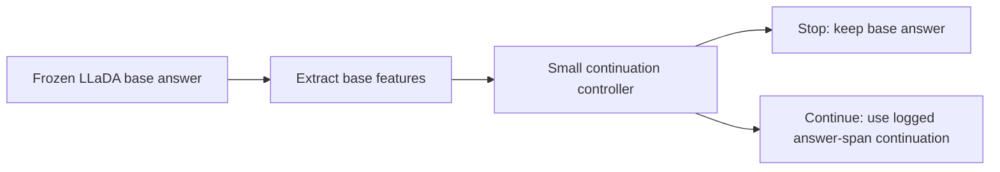

# Budget-Aware Continuation Policies for Frozen Diffusion LLMs

A research project on **adaptive inference for diffusion language models**: learn when an answer should receive extra decoding steps, and when the model should stop.

The main workflow uses a frozen **LLaDA-8B-Instruct** model to collect paired base and continued answers on GSM8K. A small neural contextual-bandit controller learns a binary stop/continue decision from confidence, verifier, formatting, and budget features. A budget-conditioned variant adds the requested compute-cost weight as an input so one policy can operate at several cost settings.

**Status:** research prototype with CPU tests and an offline policy-training/evaluation workflow. Model weights, collected datasets, trained checkpoints, and raw experiment logs are not included. The reported experiment tables are preserved with their evidence limits in [Historical results](docs/results.md).

## How it works



The controller is trained and evaluated against logged outcomes for both actions. Its checkpoints are not yet wired into the online generation loop. The large language model stays frozen.

## Included work

- Paired base/continuation generation with configurable extra-step budgets and answer-span remasking.
- Fixed-cost and budget-conditioned neural controllers, plus heuristic and classical baselines.
- Explicit feature selection that excludes ground-truth answers and correctness labels from controller inputs.
- Accuracy, utility, continuation rate, fixes, harms, and extra-step metrics.
- Math verification, answer extraction, reward diagnostics, and earlier GRPO/unmasking experiments.
- A CPU test suite and GitHub Actions workflow.

## Quick start

Use **Python 3.12**. The default installation supports offline controller training and tests on CPU.

```bash
git clone https://github.com/Neytron557/budget-aware-diffusion-decoding.git
cd budget-aware-diffusion-decoding
python3.12 -m venv .venv
source .venv/bin/activate
python -m pip install --upgrade pip
python -m pip install -e '.[dev]'
python -m pytest -q
```

Inspect a controller's options without downloading a language model:

```bash
python -m scripts.train_budget_conditioned_neural_bandit --help
```

To train on real examples, first generate or obtain a paired continuation dataset. See the [setup and reproduction guide](docs/reproduction.md) for the GPU collection step and CPU training commands.

## Repository layout

| Path | Purpose |
| --- | --- |
| [`scripts/`](scripts/) | Continuation collection, dataset export, offline controllers, and diagnostics |
| [`common/`](common/) | Generation, lightweight unmasking policies, budgets, rewards, verifiers, and remasking |
| [`train/`](train/) | Earlier GRPO policy-training infrastructure |
| [`eval/`](eval/) | Retained evaluation and result aggregation utilities |
| [`data/`](data/) | Task loaders and code sanitization |
| [`configs/`](configs/) | Generation and historical training configurations |
| [`tests/`](tests/) | CPU tests for the implemented research components |
| [`docs/`](docs/) | Method, reproduction, results, source audit, and research history |

The [architecture map](docs/CODEMAPS/INDEX.md) explains the main entry points and configuration families.

## Read more

- [Method and evaluation boundaries](docs/method.md)
- [Environment setup and reproduction](docs/reproduction.md)
- [Historical experiment results](docs/results.md)
- [Source review and publication cleanup](docs/source-audit.md)
- [Validation and tested environment](docs/validation.md)
- [Original proposal and research notes](docs/research/README.md)
- [Contribution guide](CONTRIBUTING.md)

## Contributors

- Huseyn
- Amin

## Upstream work and license

This project builds on the source accompanying [Learning Unmasking Policies for Diffusion Language Models](https://arxiv.org/abs/2512.09106), available in the [upstream repository](https://github.com/apple-aiml-research/ml-rl-dllm). The upstream work learns token-unmasking decisions; this project's main workflow learns an offline stop/continue decision after a base answer.

The supplied [LICENSE](LICENSE), [ACKNOWLEDGEMENTS](ACKNOWLEDGEMENTS), and source copyright notices are preserved. They document the upstream software and its third-party components. Model and dataset terms are separate from the repository's source license.
